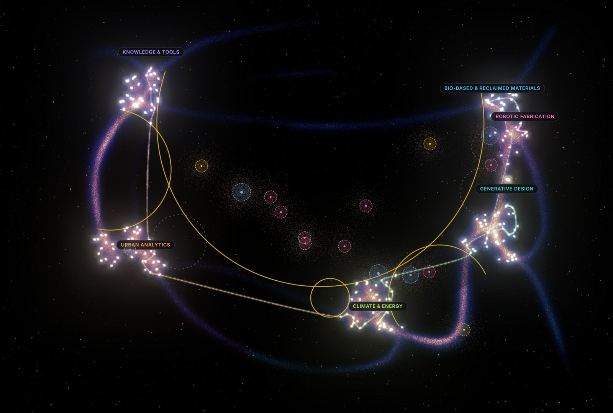
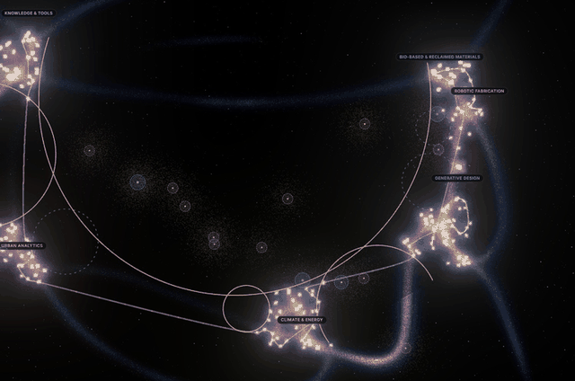
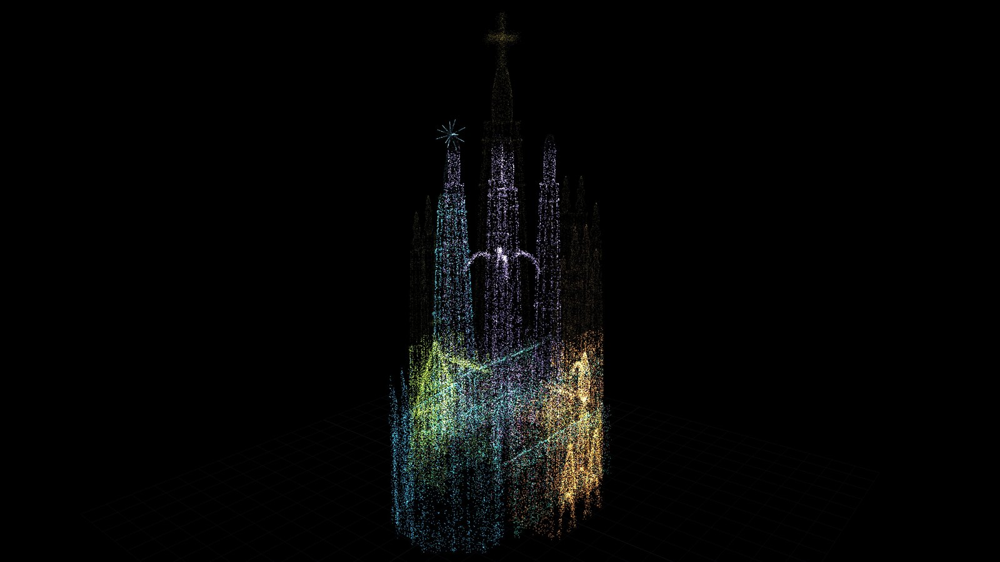
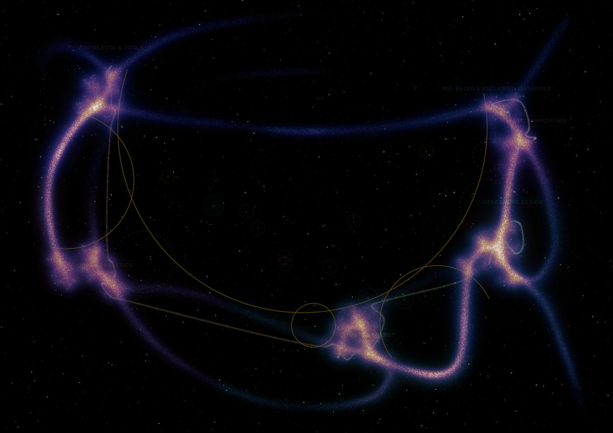
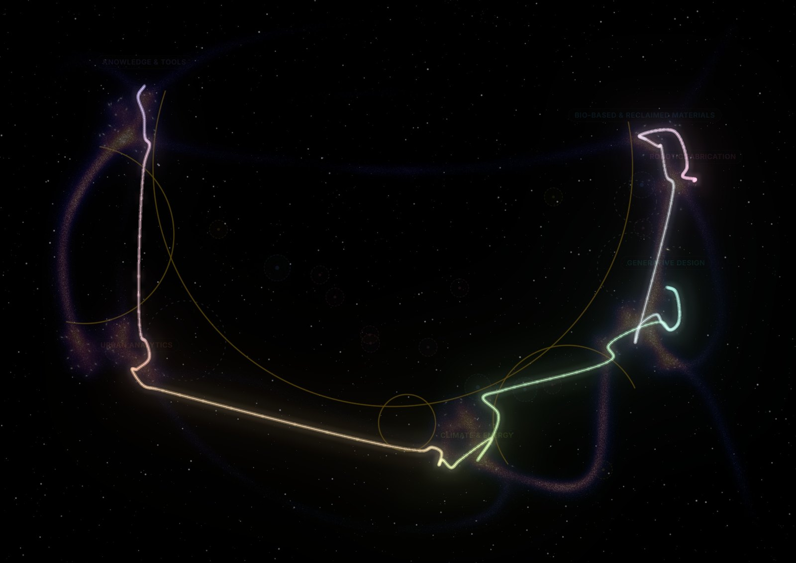
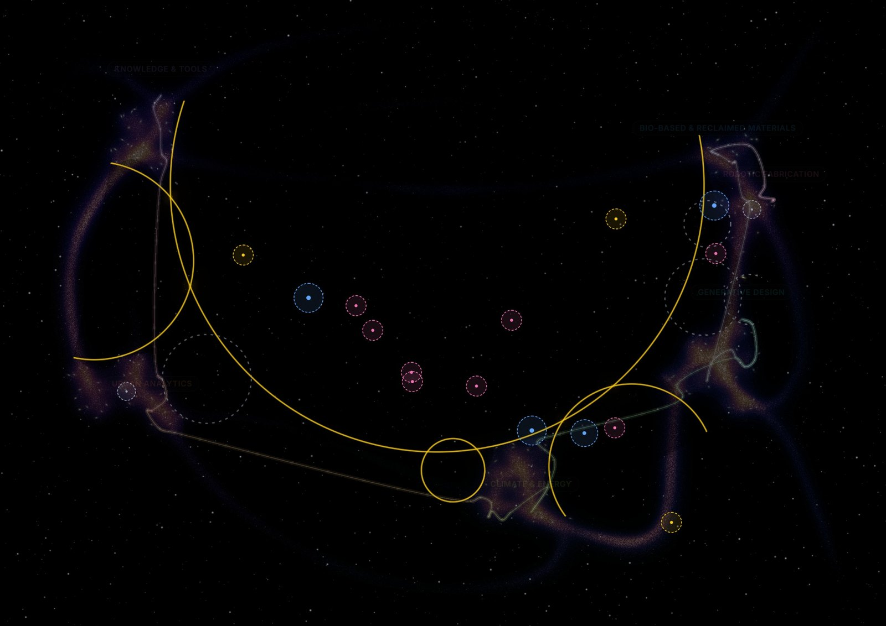
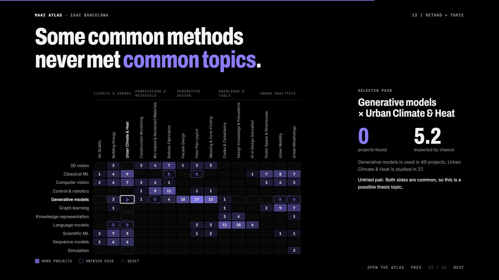
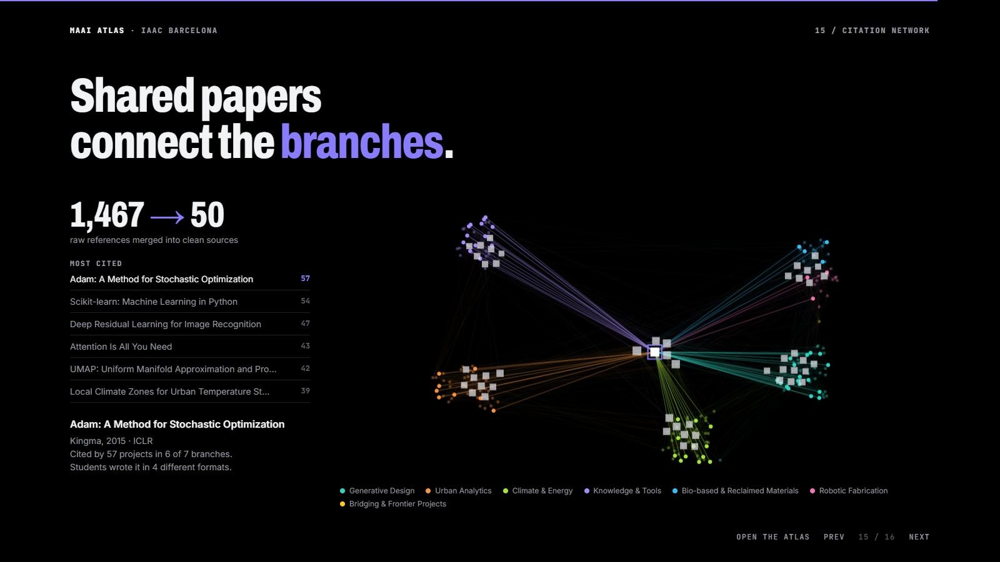
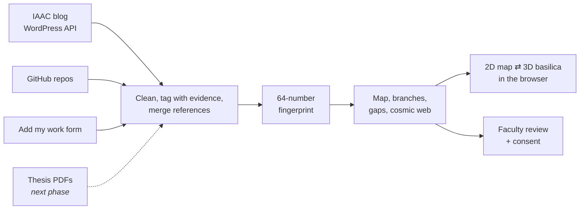

<div align="center">



# MaAI Atlas

### One searchable map of student research at IAAC Barcelona

Every project in the Master in AI for Architecture becomes a galaxy on a living map. Similar projects pull together, a slime-mould simulation grows the filaments between them, and the empty voids show where nobody has worked yet. Press one button and the same points rebuild the **Sagrada Família**: each project is a stone, each research gap is unbuilt scaffolding.


[Quick start](#quick-start) · [What you can see](#what-you-can-see) · [How it works](#how-it-works) · [Real data](#connect-the-iaac-blog) · [Presentation](#the-presentation)

</div>

---

> [!NOTE]
> **The current corpus is synthetic.** 192 generated projects stand in for real MaAI work. The pipeline, clustering, gap analysis, search and every view are real, and they run unchanged on real records. The IAAC blog connector already works (see [Connect the IAAC blog](#connect-the-iaac-blog)), but real student work stays off the public map until IAAC and the students agree.

## The problem

Every year the programme produces strong research, and a year later almost no one can find it or build on it.

| On the IAAC blog | Across the programme |
|---|---|
| **Hard to upload.** A post has no place for code, data, models or the thesis PDF. | **Scattered.** Older work lives on a different website. |
| **Hard to find.** 4,227 posts, 58 broad tags, no tag for any AI method, 27.6% of posts untagged. | **No big picture.** No view of what earlier cohorts solved, or which topics grow and fade. |
| **Not connected.** Only 2% of posts link to GitHub. | **Hidden blind spots.** Open questions next to existing work stay invisible. |

<sub>Measured through the public WordPress API of blog.iaac.net, November 2026.</sub>

## What you can see

<table>
<tr>
<td width="50%"></td>
<td width="50%"></td>
</tr>
<tr>
<td><b>From map to basilica.</b> The same points fly from the 2D map into the building. Oldest cohort first, at the base.</td>
<td><b>Research as a building.</b> Each branch builds one part of the basilica. Gaps are faint scaffold, and the frontier is the unbuilt Glory façade.</td>
</tr>
</table>

<table>
<tr>
<td width="33%"></td>
<td width="33%"></td>
<td width="33%"></td>
</tr>
<tr>
<td><b>Filaments.</b> A Physarum (slime-mould) simulation grows the paths between projects. Dust drifts along them.</td>
<td><b>Bridges.</b> Chains of projects that link two branches, tested 40 times by bootstrap.</td>
<td><b>Voids.</b> Empty regions between branches, confirmed in the full 64-dimension space.</td>
</tr>
</table>

<table>
<tr>
<td width="50%"></td>
<td width="50%"></td>
</tr>
<tr>
<td><b>Method × topic.</b> Generative models appear in 49 projects and urban heat in 27, but never together. About 5 were expected by chance.</td>
<td><b>Citation network.</b> 1,467 raw references merged into 50 clean sources. Papers that many branches share sit in the middle.</td>
</tr>
</table>

### Every view

| View | What it shows | How it is computed |
|---|---|---|
| **2D semantic map** | Projects placed by meaning | TF-IDF → truncated SVD (LSA, 64 dims) → UMAP |
| **Cosmic web style** | Galaxies, filaments, corridors, voids, drifting dust | Physarum agents (Jones 2010) on a Web Worker, Gabriel-graph food, Hessian ridge flow |
| **Research branches** | Named clusters with counts per cohort and keywords | HDBSCAN on an 8D UMAP, c-TF-IDF keywords, stability over 4 seeds |
| **3D basilica** | The same points rebuilt as the Sagrada Família | Five written rules: branch → zone by size, built share = projects ÷ (projects + gap weight), cohorts bottom-up |
| **Gap detection** | 17 candidate thesis topics, each with evidence | Map density holes, untried method × topic pairs, external literature, fading branches |
| **Project view** | Abstract, methods, data, tools, repo card, neighbours, shared references | Embedding neighbours, bibliographic coupling |
| **Reproducibility stone** | 0 to 6 score per repository; each point adds 8% to the stone | GitHub API: README, dependencies, pinned versions, data, licence, entry point |
| **Citation network** | Projects and the papers they cite | De-duplicated bibliography, d3-force pulled toward map positions |
| **Search** | Plain-language search, no server | The browser re-runs the same TF-IDF → LSA projection as the pipeline |
| **Add my work** | A student places a new project and claims scaffold | Nearest neighbours in LSA space vote for a branch; export as JSON for review |

Deep links: `#p-<project>`, `#b-<branch>`, `#g-<gap>`, `#s-<source>`, `#c-<branch>.<branch>`, `#v-<void>`.

## Quick start

```bash
git clone https://github.com/helios0007/MaAI-Atlas.git
cd MaAI-Atlas
python -m venv .venv
.venv/Scripts/python -m pip install -r requirements.txt     # macOS / Linux: .venv/bin/python
.venv/Scripts/python -m pipeline.run                        # rebuilds data/ in about 30 s (optional, data/ is included)
python -m http.server 8765                                  # open http://localhost:8765
```

The app is plain static files (ES modules, Three.js and d3 from a CDN). Any static host works, including GitHub Pages. It needs a local server, because browsers block modules and workers from `file://`.

## How it works



| Stage | File | What it does |
|---|---|---|
| 00 ingest · 01 parse | `pipeline/ingest_iaac_blog.py` | Blog posts → text, people, references, links |
| 03 extract | `pipeline/extract.py` | Taxonomy tagging; every tag keeps its source sentence |
| 04 cite | `pipeline/build_atlas.py` | Parse and de-duplicate references → `bibliography.bib` |
| 05 repos | `pipeline/repos.py` | GitHub API → 0 to 6 reproducibility rubric |
| 06 embed | `pipeline/build_atlas.py` | TF-IDF + SVD vectors |
| 07 layout | `pipeline/build_atlas.py` | UMAP, HDBSCAN, naming, stability |
| 08 gaps | `pipeline/build_atlas.py` | Four gap detectors → `reports/gap_report.md` |
| 08b structure | `pipeline/structure.py` | Cosmic-web analysis: MST corridors, Delaunay voids, cohort statistics |
| 09 search | `pipeline/build_atlas.py` | Export the vector space for the browser |
| 10 publish | `pipeline/build_atlas.py` | Basilica allocation → `data/points.bin` + `atlas_meta.json` |

Stage 02 (merging a blog post, PDF and repo into one record) and thesis PDF parsing (GROBID, OpenAlex) are not built yet. The schema and the plan are in [`docs/PIPELINE.md`](docs/PIPELINE.md).

### Why a cosmic web?

1. A plain scatter of projects is correct but hard to read.
2. Galaxies are not spread evenly: they sit on thin **filaments** around empty **voids**.
3. In 2010 a slime mould grew a network close to the Tokyo rail system (Tero et al., *Science* 327).
4. Astronomers used a slime-mould model to trace the real cosmic web between 37,000 galaxies (Burchett et al., *ApJL* 891, 2020).
5. MaAI Atlas does the same with projects: projects are galaxies, the model draws the paths, the voids are open research.

### Why the Sagrada Família?

Begun in 1882 and still unfinished, it is built by generations of architects who never met. A research programme works the same way: each project is a stone, each cohort a generation of builders, and the frontier is the Glory façade, designed but not built yet.

## Connect the IAAC blog

```bash
.venv/Scripts/python -m pipeline.ingest_iaac_blog --dry-run    # list MaAI categories and post counts
.venv/Scripts/python -m pipeline.ingest_iaac_blog              # fetch all MaAI posts (1 request per second)
set GITHUB_TOKEN=...                                           # optional, raises the GitHub rate limit
.venv/Scripts/python -m pipeline.run --source blog --fetch-repos
```

The connector reads only public posts from the MaAI categories of `blog.iaac.net` through the WordPress REST API. It writes raw posts to `data/raw/iaac_blog/` and records to `data/curated/projects_blog.json`, all with `review.status = "pending"`. Both paths are in `.gitignore`, because they contain student names. Confirm the category → cohort mapping (`COHORT_BY_CATEGORY_SUFFIX`) with the programme, and confirm with IAAC what may be published before you share anything built from real posts.

## The presentation

[`PRESENTATIONS/story.html`](PRESENTATIONS/story.html) is a 16-slide review deck with the live Atlas inside it. Slide 8 lets you show galaxies, filaments, bridges and voids one at a time, and slide 10 runs the real 2D → 3D change. The speaker script is in [`PRESENTATIONS/script.md`](PRESENTATIONS/script.md).

```bash
python -m http.server 8000        # in the repo root
# open http://localhost:8000/PRESENTATIONS/story.html   (on Windows: double-click PRESENTATIONS/present.bat)
```

Opened as a plain file, the deck still works: the live slides fall back to still images and a recorded video.

## Project layout

```
index.html, style.css, atlas.css, ui.css   page and styles
app.js                 Three.js scene, picking, inspector, gaps, search UI, upload
cosmos.js              cosmic web style: galaxies, filaments, dust, corridors, voids, focus mode
cosmicweb-worker.js    Physarum filament simulation (Web Worker)
morph.js               the 2D → 3D path shared by the shader, picking and overlays
network.js             citation network (d3-force on canvas)
search.js              in-browser TF-IDF → LSA search
home.js, ui.js         start page and shell
pipeline/              Python pipeline; taxonomy.py holds the vocabularies
data/                  built data the app loads (synthetic corpus)
reports/               gap report, run statistics, research notes for the presentation
PRESENTATIONS/         review deck, speaker script, captures
docs/                  pipeline notes and README images
legacy/, mockups/      v1 prototype and style studies, kept for reference
```

## Roadmap

- [x] Semantic map, branches, gaps, search, citation network, 3D basilica
- [x] Cosmic web style with Physarum filaments and focus mode
- [x] IAAC blog connector (read only, public posts)
- [ ] Shared backend for the "Add my work" form, with faculty review and consent
- [ ] Stage 02 merging, GROBID for thesis PDFs, OpenAlex for DOIs
- [ ] Saved UMAP model, so old projects keep their place when a new cohort is added
- [ ] Blog plugin: extra fields (GitHub, dataset, PDF) and an "Open in the Atlas" link on every post

## References

Tero et al., *Rules for biologically inspired adaptive network design*, Science 327 (2010) 439 · Jones, *Characteristics of pattern formation and evolution in approximations of Physarum transport networks*, Artificial Life 16 (2010) · Burchett et al., *Revealing the dark threads of the cosmic web*, ApJ Letters 891 (2020) L35 · Elek et al., *Monte Carlo Physarum Machine*, Artificial Life 28 (2022) 22 · McInnes et al., *UMAP* (2018) · Campello et al., *HDBSCAN* (2013)

<div align="center">
<br/>
<sub>Built at <b>IAAC</b>, the Institute for Advanced Architecture of Catalonia, for the Master in AI for Architecture and the Built Environment.</sub>
</div>
